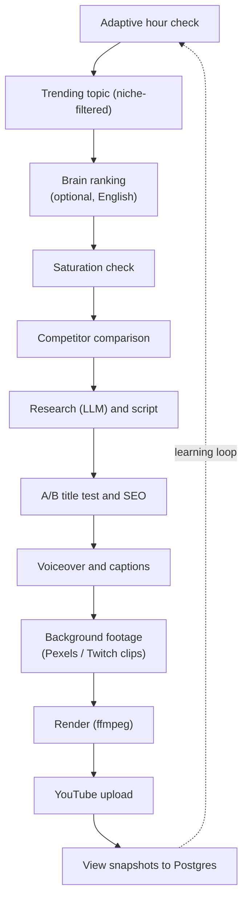
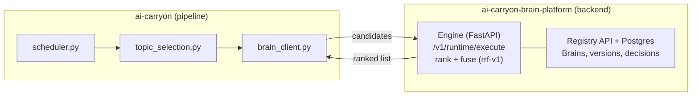

<div align="center">

# AI CarryON

### Autonomous multi-channel YouTube Shorts platform

Finds trending topics, researches them, writes scripts, produces voiceovers, renders videos, and uploads to YouTube with no human in the loop, then learns from how each video performs.

[](runtime.txt)
[](.github/workflows)
[](#architecture)
[](https://ai-carryon-tqndlmjbcfvtznagmef2ap.streamlit.app/Dashboard)
[](#architecture)

[Live dashboard](https://ai-carryon-tqndlmjbcfvtznagmef2ap.streamlit.app/Dashboard) |
[Brain Platform backend](https://github.com/Amit-coder78/ai-carryon-brain-platform) |
[Backend architecture](https://htmlpreview.github.io/?https://github.com/Amit-coder78/ai-carryon-brain-platform/blob/main/docs/architecture/index.html)

</div>

---

## Overview

AI CarryON runs **seven independent pipelines**, each with its own content source, audience, credentials, and schedule, all deployed as scheduled GitHub Actions workflows at zero hosting cost. Five are documented here as production channels; Finance and Horror have their own docs ([`FINANCE.md`](FINANCE.md), [`HORROR.md`](HORROR.md)).

| | |
| --- | --- |
| **Compute** | GitHub Actions cron workflows (stateless runs) |
| **State** | Supabase Postgres, partitioned per channel |
| **LLMs** | Groq `openai/gpt-oss-120b` primary, Gemini fallback, with circuit breakers and call budgets |
| **Decision backend** | [ai-carryon-brain-platform](https://github.com/Amit-coder78/ai-carryon-brain-platform): versioned "Brains" that rank candidate topics |
| **Voice** | Edge TTS, Sarvam AI (Hindi) |
| **Media** | Pexels and Twitch clips, ffmpeg rendering |
| **Dashboard** | Streamlit, reading the same Postgres database |
| **Channels** | [English](https://www.youtube.com/@AIcarryONAI) / [Hindi](https://www.youtube.com/@AICarryONHindi) / [Cricket](https://www.youtube.com/@AICarryONSports) / [Gaming](https://www.youtube.com/@AICarryONGaming) |

### Highlights

- **Fully autonomous**: topic discovery to YouTube upload, with learned peak-hour scheduling.
- **Self-improving**: velocity tracking, saturation scoring, competitor benchmarking, and A/B title testing feed back into every run.
- **Resilient by design**: provider fallback, per-channel API key isolation, resumable runs, and a backend that can never block a video if it fails.
- **Zero-cost infrastructure**: migrated off paid hosting to scheduled workflows plus Postgres.

## Contents

[Channels](#channels-in-production) | [Pipeline](#what-each-pipeline-does) | [Architecture](#architecture) | [Brain Platform backend](#brain-platform-backend) | [Intelligence layer](#intelligence-layer-english-hindi-and-bhakti) | [Engineering highlights](#engineering-highlights) | [Local setup](#local-setup) | [Deployment](#deployment) | [Operational notes](#operational-notes) | [Hook engine](#hook-engine) | [Comment replies](#comment-reply-agent) | [Limitations](#known-limitations) | [Roadmap](#roadmap)

---

## Channels in Production

| Channel | Audience / Niche | Content source | Voice | Workflow |
| --- | --- | --- | --- | --- |
| **English** ([@AIcarryONAI](https://www.youtube.com/@AIcarryONAI)) | US, Tech/AI | Trending-topic discovery + LLM research | Edge TTS | `english-scheduler.yml` (every 5h) |
| **Hindi** ([@AICarryONHindi](https://www.youtube.com/@AICarryONHindi)) | India, experiment-style videos (chemical, physical and technology experiments from around the world) | LLM-generated trending topics, Hinglish scripts | Sarvam AI Bulbul, Edge TTS fallback | `hindi-scheduler.yml` (hourly check, adaptive, max 3 uploads/day) |
| **Cricket** ([@AICarryONSports](https://www.youtube.com/@AICarryONCricket)) | Cricket news and match content | CricAPI match data + trending cricket topics | Edge TTS | `cricket-scheduler.yml` |
| **Gaming** ([@AICarryONGaming](https://www.youtube.com/@AICarryONGaming)) | Gaming moments and trends | Twitch Helix Clips API (followed streamers + top clips by game category) | Edge TTS | `gaming-scheduler.yml` |
| **Bhakti** | India, Hindi devotional Shorts (mythological stories, mantra meanings, festival significance) | Devotional topic pool + live trend check, LLM research, Pexels temple/diya/aarti footage, Freesound bhajan-style music | Sarvam AI (devotional pace); `BHAKTI_MODE=music_only` skips voice and captions | `bhakti-scheduler.yml` (hourly check, adaptive, up to 6 uploads/day) |

The Hindi channel was pivoted from tech news to experiment-style videos after poor retention, to make content more visual and interactive.

The Bhakti channel is the fifth pipeline and is documented in [`SETUP_BHAKTI.md`](SETUP_BHAKTI.md). It has two modes: `narrated` (the default: Hindi voiceover and captions over a ducked bhajan track) and `music_only` (bhajan only, no voice). It uses stock footage only, with no AI-generated deity imagery, and it reuses the English/Hindi intelligence layer (saturation, comparison, A/B titles, velocity).

---

## What Each Pipeline Does

Every channel runs on its own schedule and, without human input:

1. Checks whether the current hour matches a learned peak-engagement window (English/Hindi/Bhakti; falls back to safe defaults until enough data exists)
2. Finds a trending topic, filtered to the channel's niche
3. Checks topic saturation and skips topics that are already over-covered (English/Hindi/Bhakti)
4. Benchmarks competitors on the same topic (English/Hindi/Bhakti)
5. Researches the topic and writes a script tuned to the channel's length and style
6. Generates three title variations using different psychological patterns, scores them, and picks a winner
7. Writes the SEO description and hashtags
8. Generates a voiceover and word-by-word captions
9. Pulls background footage: topic-relevant Pexels video clips (English, Hindi, Cricket, Bhakti), or real Twitch clips downloaded with `yt-dlp` (Gaming)
10. Renders the final video with ffmpeg
11. Uploads to YouTube with full metadata
12. Records view snapshots on a schedule for ongoing analytics

### Pipeline (per channel)



---

## Architecture

**Compute and scheduling.** Each channel is a GitHub Actions cron workflow (`.github/workflows/`). Runs are stateless, so all state lives in Postgres and all credentials in GitHub Secrets.

**LLM routing.** Groq (`openai/gpt-oss-120b`) is the primary model, with Gemini (`gemini-3.5-flash`) as fallback. The English and Hindi routing layers (`model_invoke_agent_english.py`, `model_invoke_agent_hindi.py`) include circuit breakers and per-run call budgets so a provider outage or rate limit degrades gracefully instead of failing a run.

**Data.** Supabase Postgres, accessed through the transaction pooler (port 6543), because GitHub Actions runners are IPv4-only and Supabase direct connections are IPv6-only. English, Hindi and Bhakti share one database, partitioned by a `channel` column so their learning never mixes. Cricket uses its own Supabase project for topic de-duplication.

**Dashboard.** A Streamlit app on Streamlit Community Cloud reads the same Postgres database. Pages: Dashboard, Peak Hours, Schedule, Analytics, Comparison, and A/B Titles. The channel selector covers English, Hindi, and Cricket. The dashboard has no Bhakti tab yet; Bhakti data is stored in the shared Postgres database under `channel='bhakti'`.

**Shared rendering.** Every channel reuses the same video renderer (`agents/video_agent.py`), so a fix or improvement there benefits every channel.

### Repository Layout

| Path | Contents |
| --- | --- |
| `agents/` | English pipeline agents and shared video, voice and caption agents (includes `brain_client.py` and `topic_selection.py`, the Brain platform client) |
| `agents_hindi/` | Hindi (Hinglish) pipeline agents |
| `agents_cricket/` | Cricket pipeline agents |
| `agents_gaming/` | Gaming pipeline agents (Twitch client, clip finder, etc.) |
| `agents_bhakti/` | Bhakti (Hindi devotional) pipeline agents |
| `tests/` | Offline tests (comment engine, Brain topic selection, and more) |
| `pages/` | Streamlit dashboard pages (includes the **Semantic Brain** evaluation page) |
| `tools/` | Offline tools, including `eval_semantic.py` (weekly Semantic Brain evaluation) |
| `scheduler*.py` | One scheduler per channel: `scheduler.py`, `scheduler_hindi.py`, `scheduler_cricket.py`, `scheduler_gaming.py`, `scheduler_bhakti.py` |
| `app.py` | Streamlit entrypoint |
| `.github/workflows/` | English, Hindi, Cricket, Gaming and Bhakti scheduler workflows |

---

## Brain Platform backend

AI CarryON uses a separate repository, [**ai-carryon-brain-platform**](https://github.com/Amit-coder78/ai-carryon-brain-platform), as its **decision-making backend**. This repo (the pipeline) is the *client*; the Brain platform is the *service* that ranks candidate topics before a video is made.

**Architecture of the backend:** [open the interactive diagram](https://htmlpreview.github.io/?https://github.com/Amit-coder78/ai-carryon-brain-platform/blob/main/docs/architecture/index.html)



### How the two repos connect

| Piece | Location |
| --- | --- |
| HTTP client for the engine | [`agents/brain_client.py`](agents/brain_client.py) |
| Topic choice using the ranking | [`agents/topic_selection.py`](agents/topic_selection.py), called from `scheduler.py` |
| Engine started inside the CI job | `.github/workflows/english-scheduler.yml` uses `Amit-coder78/ai-carryon-brain-platform/.github/actions/ci-engine@main` |
| API contract both sides follow | [`contracts/openapi.yaml`](https://github.com/Amit-coder78/ai-carryon-brain-platform/blob/main/contracts/openapi.yaml) in the Brain platform repo |

### What the Brain does for the pipeline

1. The scheduler builds a shortlist of trending topics (topics posted in the last 24h are dropped first).
2. It sends them to `POST /v1/runtime/execute` with signals per topic: freshness (`days_since_trend`) and viewer demand from `topic_requests` over 30 days (`unique_requesters` = distinct commenters via `author_channel_id`).
3. The engine runs the channel's attached Brains, fuses their rankings, and returns the order plus a `decision_id`.
4. The pipeline tries topics in Brain order; each must still pass the saturation check.
5. Every Brain-assisted decision logs one `BRAIN_LOG {...}` line (source, execution id, policy version, Brain versions).

### Safe by default

**Off unless configured; with nothing set there is no extra network call and behaviour is unchanged.** Any failure, a `baseline_fallback`, or a ranking with no preference (`no_signal`) falls back to the original selection. A Brain problem can never fail a video run.

### Enabling it (English channel)

Add a GitHub repository **variable** `BRAIN_ENABLED` = `true` (Settings > Secrets and variables > Actions > Variables). The English workflow then starts the engine inside the job, so there is nothing to host. Remove the variable (or set it to anything else) to switch it off. If the engine fails to start, the run continues without the Brain.

To use a separately hosted engine instead, leave `BRAIN_ENABLED` unset and set these yourself:

| Variable | Purpose |
| --- | --- |
| `BRAIN_ENGINE_URL` | Engine base URL, reachable from the runner |
| `BRAIN_WORKSPACE_ID` | Workspace uuid in the Brain registry (sent as `x-workspace-id`) |
| `BRAIN_CHANNEL_ID_ENGLISH` | Registry channel uuid (`BRAIN_CHANNEL_ID_<CHANNEL>` for others) |
| `BRAIN_ENABLED=0` | Kill switch in the environment |

Cost when enabled: one extra YouTube search call per run. Other channels can adopt it with `brain_ranked_topic("<channel>")` and `BRAIN_CHANNEL_ID_<CHANNEL>`.

Tests (offline): `python -m unittest tests.test_brain_topic_selection -v`

### Decision log (always on when the Brain runs)

The engine started inside the job is thrown away afterwards, so the pipeline keeps its own record. Each Brain-assisted ranking writes one row per candidate to the persistent `topic_decisions` table: the features that were sent, every Brain's score (including **shadow** Brains, which are reported but never change the order), the fused score and rank, and a flag on the topic that was actually used. This is the data any later learned model (and any honest evaluation of the Brain) needs, because it records what was *offered*, not only what was published. A logging problem never affects topic choice.

### Semantic features (optional, shadow first)

Answers "how did this channel's most similar past videos do, and is this a repeat of something posted recently?". A frozen multilingual sentence encoder embeds each candidate; the code finds that channel's nearest past videos and sends only three numbers per topic (`neighbor_ratio`, `neighbor_count`, `max_similarity_recent`) to the platform's `semantic` Brain. No text leaves the pipeline, nothing is trained, and nothing is fine-tuned.

| Variable (repository **Variables**) | Purpose |
| --- | --- |
| `BRAIN_SEMANTIC_ENABLED` | `true` to compute the features (also needs `BRAIN_ENABLED`) |
| `BRAIN_TEXT_MODEL_NAME` | Hugging Face model id. Choose one that covers Hindi and English and **test it on your own topics first** |
| `BRAIN_TEXT_MODEL_REVISION` | Immutable commit hash of that model. Required; a floating revision is refused because it is part of the cache key |
| `BRAIN_SEMANTIC_ROLE` | `shadow` (default; scored and logged, never changes the order), `supporting` (votes in rank fusion) or `off` |

Everything fails open: no model, no library, no history or any error means no semantic features and the original behaviour. Vectors are cached in the `text_embeddings` table by text hash, model, revision and preprocessing version, and model weights are cached between runs. Install the extra dependencies with `pip install -r requirements_semantic.txt` (not part of `requirements.txt`, so the other channels never pull in torch).

**Point in time:** a past video's outcome only counts once its 24h window has closed, "recent" means strictly before now, and neighbours come from the same channel only. Outcome = views at about 24h after publish (snapshot within 6h of that mark, else the closed A/B-test `actual_views_24h`).

**Do not promote on faith.** `.github/workflows/semantic-eval.yml` runs weekly and, per channel, replays history exactly as it would have looked at each video's publish time (`python -m tools.eval_semantic --channel english`). The gate needs at least 30 scored videos, a bootstrap 95% interval for the improvement over "predict the median" that stays above zero, and a positive rank correlation. Until a channel passes, keep the Brain in `shadow`. The thresholds (`BRAIN_SEMANTIC_MIN_SIMILARITY`, `_K`, `_RECENT_DAYS`) are starting values to calibrate on your logged data, not tuned numbers.

**Dashboard.** The weekly evaluation saves each report to the `semantic_eval_reports` table (`--save`), and the **Semantic Brain** page in the dashboard sidebar shows it: one row per channel with its status and what is still missing, the trend of the improvement over time with its 95% interval, and a live summary of the decision log (what was offered, what the shadow Brain thought, what was used). It is read-only and sits behind the same `APP_PASSWORD` login as the other pages.

**Where each channel's history comes from.** English, Hindi, Bhakti and Horror use the shared `videos` and `snapshots` tables. Cricket and Gaming keep their own `cricket_*` and `gaming_*` tables, so the evaluation reads those through each channel's own database module (`history_rows` in `agents/semantic_features.py`). Finance stores no videos or view counts, and Horror has no view tracker yet, so neither can be measured.

**Why a channel can show no result.** A video only counts once a view snapshot exists within 6 hours of its 24-hour mark, so having many total views is not enough. When nothing can be scored, the saved report and the dashboard say which case applies: no videos found, no snapshot near 24h, too few measured videos, no similar past video, or a data source that could not be read. A result that is no better than the channel median is reported as exactly that, not as luck.

Tests (offline, no model download): `python -m unittest tests.test_semantic_features tests.test_eval_semantic tests.test_semantic_report tests.test_semantic_channel_sources tests.test_semantic_dashboard_page -v` (the page test needs `streamlit` and is skipped without it).

---

## Intelligence Layer (English, Hindi and Bhakti)

| Component | What it does |
| --- | --- |
| **Velocity and peak-hour detection** | Computes views gained per hour per video, aggregated by hour of day, to find the best upload windows |
| **Saturation engine** | Scores topics 0-100 from recent competing video count and authority-channel coverage. Fails open if the YouTube API is unavailable |
| **Comparison engine** | Benchmarks the top 10 competing videos (views, engagement, title length, duration) and feeds recommendations into script and SEO generation |
| **A/B title testing** | Generates 3 titles from 8 psychological patterns, scores each on a 10-point rubric, and logs every test for pattern tracking |
| **Adaptive scheduling**              | Scores every UTC hour from an audience-heatmap prior + recent view velocity + 24h views by upload hour (last 28 days), and uploads only in the best 6 hours; the prior can be updated via the DB meta key `audience_prior_ist_<channel>` |
| **View tracking** | Hourly snapshots of views, likes, and comments per video |

---

## Engineering Highlights

- **Moved off paid hosting to a zero-cost deployment.** English and Hindi were migrated from Railway (which began requiring a credit card) to GitHub Actions cron workflows. The SQLite store was replaced with Postgres so state survives across stateless runs. The gaming channel was built directly on the same pattern.
- **Replaced the database layer.** The original per-feature JSON files became a single SQLite database and then Supabase Postgres, with an idempotent migration script and a timezone fix for mixed naive/aware timestamps that had silently broken velocity calculation.
- **Survived a model deprecation.** When Groq retired `llama-3.3-70b-versatile`, roughly 25 hardcoded call sites across all channels were migrated to `openai/gpt-oss-120b`, and a retired Gemini model in the routing layer was replaced.
- **Upgraded visuals from static to dynamic.** Ken-Burns still images were replaced with topic-relevant Pexels video clips for English and Hindi.
- **Fixed silent audio truncation in Hindi TTS.** Sarvam splits long text into multiple WAV segments and only the first was being saved, cutting about 70% of each voiceover. Concatenating all segments fixed it, and script length was retuned to 110-130 words to stay under the 60-second Shorts limit.
- **Built the gaming pipeline end to end.** Twitch OAuth app registration, Helix Clips API integration, per-clip download with `yt-dlp`, and a category filter that automatically excludes non-gameplay categories (Just Chatting, Music, ASMR, etc.) from top-clip discovery.
- **Cricket state moved to Postgres.** De-duplication tracking was moved from a JSON file to Supabase so it survives ephemeral compute.

---

## Local Setup

```bash
git clone https://github.com/Unknown183-a/ai-carryon.git
cd ai-carryon
python3 -m venv .venv
source .venv/bin/activate
pip install -r requirements.txt

# Dashboard
streamlit run app.py

# Run a channel scheduler locally
python scheduler.py           # English
python scheduler_hindi.py     # Hindi
python scheduler_cricket.py   # Cricket
python scheduler_gaming.py    # Gaming
python scheduler_bhakti.py    # Bhakti
```

### Configuration

| Variable | Purpose | Scope |
| --- | --- | --- |
| `DATABASE_URL` | Postgres connection (Supabase transaction pooler) | All |
| `GROQ_API_KEY` | Primary LLM inference | All |
| `GEMINI_API_KEY` | LLM fallback | All |
| `PEXELS_API_KEY` | Background clips and images | English, Hindi, Cricket, Bhakti |
| `YOUTUBE_API_KEY` | YouTube Data API (search, public stats) | All |
| `YOUTUBE_TOKEN_B64`, `YOUTUBE_CLIENT_SECRETS_B64`, `YOUTUBE_ANALYTICS_TOKEN_B64` | English OAuth upload and analytics credentials | English |
| `YOUTUBE_TOKEN_JSON` / `HINDI_TOKEN_JSON` | Hindi OAuth token (needs `youtube.upload`, `youtube.readonly` and `youtube.force-ssl` scopes) | Hindi |
| `SARVAM_API_KEY` | Hindi native TTS | Hindi, Bhakti |
| `BHAKTI_TOKEN_JSON` | Bhakti OAuth token (needs `youtube.upload`, `youtube.readonly` and `youtube.force-ssl`) | Bhakti |
| `YOUTUBE_BHAKTI_CHANNEL_ID`, `BHAKTI_AUTHORITY_CHANNEL_IDS` | Own channel id and authority channels for saturation scoring | Bhakti |
| `FREESOUND_API_KEY` | Bhajan-style background music | Bhakti |
| `BHAKTI_MODE`, `BHAKTI_VIDEOS_PER_DAY` | `narrated` (default) or `music_only`; daily upload target (default 6) | Bhakti |
| `TWITCH_CLIENT_ID`, `TWITCH_CLIENT_SECRET` | Twitch Helix API | Gaming |
| `YOUTUBE_GAMING_CLIENT_SECRETS_B64`, `YOUTUBE_GAMING_TOKEN_B64` | Gaming channel OAuth credentials | Gaming |
| `APP_PASSWORD` | Streamlit dashboard login | Dashboard |

Cricket additionally needs a CricAPI key and its own YouTube credentials.

---

## Deployment

All five pipelines deploy the same way: push to `main`, and the scheduled workflows in `.github/workflows/` pick up the new code on their next run. Secrets live in GitHub repository secrets. To trigger a run without waiting for the cron, use "Run workflow" on the relevant workflow in the Actions tab.

---

## Operational Notes

- **YouTube API quota**: 10,000 units/day per Google Cloud project, and each upload costs about 1,650 units. The gaming channel uses its own Google Cloud project and OAuth client.
- **API key isolation**: each channel workflow uses its own `GROQ_API_KEY_<CHANNEL>`, `GEMINI_API_KEY_<CHANNEL>` and `PEXELS_API_KEY_<CHANNEL>` secret (Hindi, Cricket and Bhakti also get `SARVAM_API_KEY_<CHANNEL>`). The old shared keys are passed as `*_API_KEY_SHARED`, and `key_fallback.py` retries a call with the shared key only on 429/401/403 (`KEY_FALLBACK=0` disables it). Tests: `python -m unittest tests.test_key_fallback -v`.
- **OAuth tokens** can expire (`invalid_grant`). Re-authenticate locally and update the matching GitHub secret. A Hindi token with upload-only scope silently fails view tracking with a 403.
- **Sarvam text limits**: long scripts come back as multiple audio chunks, so always concatenate every returned segment.
- **Flow/Veo clips**: an optional manual mode for cinematic clips exists in the English and Hindi agents (`flow_prompt_agent.py`), but the automated pipelines use Pexels or Twitch footage. Real brand names in clip prompts can trigger Flow's policy filter.

## Hook Engine

Every Short can open on a topic-relevant visual hook (1-3s), chosen before the normal B-roll.

```
script -> story analysis + hook intent -> 3-5 queries -> Pexels (10-20 candidates)
       -> score (relevance 40 / visual 25 / curiosity 20 / emotion 10 / continuity 5)
       -> relevance >= 70% gate -> duplicate check -> best hook -> render first
```

- Code: `agents/hook_engine.py` (shared core + per-channel profiles), `agents/hook_render.py` (renderer helper), `agents_gaming/gameplay_hook.py`. Pexels search goes through the existing client: `agents/video_clip_agent.py::search_hook_videos()`.
- The hook **replaces** the first seconds of B-roll; total length, voice and caption timing are unchanged.
- English, Hindi, Cricket, Bhakti use Pexels. Bhakti is restricted to reverent hook types and blocks dramatic/violent/deity terms. Gaming cuts a cold open from the real gameplay peak (vision-analysed, intensity >= 6 only).
- Relevance is judged from the Pexels clip **title** (no tags/description exist), blended 75/25 with a keyword-overlap check. No suitable hook -> the video renders exactly as before.
- Duplicates: per-channel history in the DB meta table (`hook_history:<channel>`), 14-day cooldown, recorded only after a successful upload. Selections are logged as `HOOK_LOG {...}` lines.
- Env: `HOOK_ENGINE=0` (off everywhere), `HOOK_ENGINE_<CHANNEL>=0`, `HOOK_MIN_RELEVANCE`, `HOOK_REUSE_COOLDOWN_DAYS`, `GAMING_HOOK_MIN_INTENSITY`.
- Tests: `python -m unittest tests.test_hook_engine -v`

## Comment Agent

One shared engine (`comment_engine/`) serves all seven channels (cricket, gaming, finance, horror, english, hindi,
bhakti). Each channel has a validated persona in `comment_personas/<persona>.yaml`; the engine is built to
**draft first**: by default nothing is posted until the owner approves it, and the owner can switch a channel to
auto-reply (below).

```
sync (official YouTube API) -> classify -> generate (persona + video context + examples)
  -> validate (hard rules, then LLM judge) -> draft -> owner approve/edit/reject -> publish
```

- **Safe by default.** `COMMENT_AGENT_ENABLED` is off, mode is `draft`, and a channel can only publish if its owner turned
  publishing on *and* either approved that specific draft or switched the channel to auto-reply. Publishing re-validates, re-checks the thread, and reconciles with
  YouTube after a timeout so a reply is never posted twice. Kill switches: `COMMENT_AGENT_ENABLED=false`, per-channel `pause`.
- **Untrusted input.** Comments/descriptions are data, never instructions; spam, links, threats, personal data and prompt
  injection are screened before any LLM call. Validator rules per domain: no guaranteed returns or personal investment advice
  (finance), no invented scores/stats (cricket), no fabricated scripture or divine-outcome promises (bhakti).
- **Keeps feeding the Brain.** When a viewer asks for a specific video (intent `suggestion`), the requested topic is saved to
  `topic_requests` with the commenter's `author_channel_id` (cricket: `cricket_match_requests`), exactly once per comment, even when
  the reply is skipped or held for review. The Brain's demand signal reads these rows.
- **Isolation.** Every table and query is scoped by `(tenant_id, channel_id)`; each channel uses its own token.
- **Auto-reply (per-channel owner switch, off by default).** Actions -> Comment Agent -> `enable-auto-reply` (and
  `disable-auto-reply`). With it on, each daily cycle approves *by policy* and posts only drafts that passed every check
  (the approval is recorded as `auto-policy` in the audit trail). Drafts that need review (sensitive topics, personal
  finance advice, threats, devotional crises, failed checks) are never auto-posted and wait for you. Also: only comments from the last
  7 days (`COMMENT_AGENT_AUTO_MAX_AGE_DAYS`), at most the persona's `max_replies_per_run` (20) per cycle, ~15 s between
  replies (`COMMENT_PUBLISH_DELAY_SECONDS`), and the kill switch / channel `pause` stop it at once.
- **Persona edits without code:** `python -m comment_engine persona --channel cricket --set voice.emoji_level=low`
  (allowed: language, humor/assertiveness/emoji/slang level, max sentences, publishing mode).
- **Runs once a day, at each channel's peak-viewer hour (no fixed clock time).** The hourly workflow *Comment Agent (auto)*
  asks which channels have reached their peak hour today and haven't run yet; only those run. The peak hour comes from the repo's
  own view tracking (average views gained per hour of day, UTC), falling back to the hours that channel's viewers actually
  comment, and a channel with no data yet runs at the next opportunity (which also starts collecting data). A US-audience
  channel therefore runs at US viewing time and an Indian one at Indian viewing time, automatically. Missed cron slots run later
  the same day; failed or aborted cycles retry up to 3 times. Check any channel with Actions -> Comment Agent -> `peak`.
  Needs the repo variable `COMMENT_AGENT_ENABLED=true`; `COMMENT_AGENT_CHANNELS` (default `cricket`) lists the channels to run.

**No local setup needed:** open **Actions -> Comment Agent -> Run workflow**, pick a channel and an action (`run`, `drafts`,
`approve`, `edit`, `reject`, `publish`, `enable-publishing`, `pause`, `metrics`, `test`). It runs with the repo's secrets, shows the
result in the run summary, and only the chosen channel's YouTube token is loaded. The commands below are the same actions for local use.

Owner workflow (repo variables set `COMMENT_AGENT_ENABLED=true`, `COMMENT_AGENT_CHANNELS=cricket`):

```
python -m comment_engine run       --channel cricket            # sync + draft
python -m comment_engine drafts    --channel cricket            # review queue
python -m comment_engine edit      --channel cricket --draft ID --text "..."
python -m comment_engine approve   --channel cricket --draft ID
python -m comment_engine publishing --channel cricket --on on   # one-time owner opt-in
python -m comment_engine publish   --channel cricket --draft ID # or set COMMENT_AGENT_DEFAULT_MODE=publish_approved
python -m comment_engine test      --channel cricket --text "kitne run chahiye the?"   # no DB/YouTube
```

Other commands: `feedback` (on_brand, too_generic, too_polite, too_aggressive, incorrect, irrelevant - on_brand replies become
style examples), `metrics`, `events` (audit trail), `purge --days N`, `validate-personas`.

Settings: `COMMENT_AGENT_ENABLED`, `COMMENT_AGENT_CHANNELS`, `COMMENT_AGENT_DEFAULT_MODE` (`draft`|`publish_approved`),
`COMMENT_AGENT_MAX_COMMENTS_PER_RUN`, `COMMENT_AGENT_MAX_REGENERATION_ATTEMPTS`, `COMMENT_AGENT_DUPLICATE_WINDOW`,
`COMMENT_AGENT_REQUIRE_APPROVAL`, `COMMENT_AGENT_SEMANTIC_CHECK`, `COMMENT_AGENT_TENANT_ID`. Bad values fail closed.

Tokens must include `youtube.force-ssl`. State lives in the shared database (`comment_agent_*` tables).
Tests: `python -m pytest tests/test_comment_agent.py -q`

## Known Limitations

- Sarvam Hindi TTS currently errors on `target_language_code` and falls back to Edge TTS
- Custom thumbnail upload is blocked by a 403 on some channels (likely requires channel phone verification)
- The comment agent needs the `youtube.force-ssl` OAuth scope on every channel token (see the Comment Agent section)
- Bhakti has no tab in the Streamlit dashboard yet (its data is in the database)
- The Semantic Brain cannot be evaluated for Finance (no stored videos or view counts) or Horror (no view tracker) until those exist
- Saturation gating is not bypassed by `FORCE_GENERATE` (only the schedule-hour gate is)

---

## Roadmap

- **Close the A/B loop**: title scores are LLM-predicted today. Validate them against real 24h view counts and let pattern selection use ground truth.
- **Extend the intelligence layer to Cricket and Gaming**: saturation, comparison, and adaptive scheduling currently run for English and Hindi only.
- **Promote the semantic Brain per channel**: it runs in shadow mode with a weekly evaluation and a dashboard page. Promote a channel only after it passes the evaluation gate. A learned model (CatBoost) and fine-tuning wait for enough logged decisions.
- **Failure and hook analysis**: systematic tracking of why videos underperform.
- **Audience, opportunity, and monetization intelligence**: demographic pulls, pre-trend prediction, and RPM-correlated topic scoring.
- **Centralized "brain" service**: built as [ai-carryon-brain-platform](https://github.com/Amit-coder78/ai-carryon-brain-platform) and live for English topic ranking (see [Brain Platform backend](#brain-platform-backend)). Next: roll it out to the other channels.
- **Multi-tenant SaaS rebuild**: a from-scratch rebuild of this pipeline as a multi-tenant platform (FastAPI, Firebase, Celery workers on Cloud Run) lives in [ai-carryon-saas](https://github.com/Unknown183-a/ai-carryon-saas).

---

## Additional pipelines

| Pipeline | Description | Docs |
| --- | --- | --- |
| **Finance** | Stock-market and finance education Shorts with a fact-check gate on every script | [`FINANCE.md`](FINANCE.md) |
| **Horror** | Original English horror stories (clearly labelled fiction), Shorts or long-form | [`HORROR.md`](HORROR.md) |

---

<div align="center">

**AI CarryON** | Built by Amit Kumar

</div>
